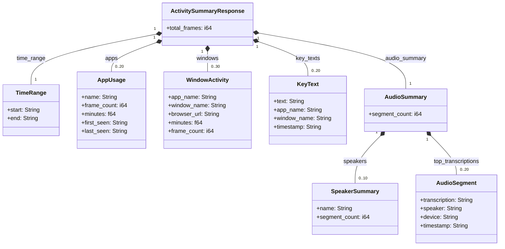
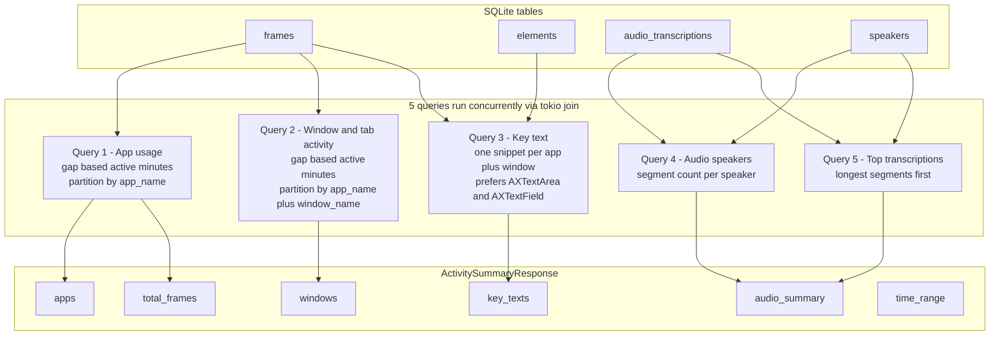

# `activity-summary` — How It Works

`activity-summary` is an MCP tool (and underlying `GET /activity-summary` REST
endpoint) that gives an AI agent a compressed, human-readable overview of what
the user was doing over a time range. This doc explains the SQL behind it and
the shape of its response.

Source: `crates/screenpipe-engine/src/routes/activity_summary.rs`
MCP wrapper: `packages/screenpipe-mcp/src/index.ts` (`case "activity-summary"`)

## Request

| Param | Required | Notes |
|---|---|---|
| `start_time` | yes | ISO 8601 UTC or relative (e.g. `"3h ago"`) |
| `end_time` | yes | ISO 8601 UTC or relative (e.g. `"now"`) |
| `app_name` | no | Filter to a single app |

## The core trick: measuring "active minutes" without a duration column

`frames` only stores timestamps of periodic screenshots — there's no
start/end duration per app. Queries 1 and 2 use a **gap-based heuristic**:
look at the time between *consecutive* frames of the same app/window. If the
gap is small (< 300s / 5 min), count it as active time. If the gap is large
(user stepped away or switched apps for a while), don't count it.

```sql
JULIANDAY(LEAD(timestamp) OVER (PARTITION BY app_name ORDER BY timestamp)) - JULIANDAY(timestamp)) * 86400 AS gap_sec
```

- `LEAD(timestamp) OVER (PARTITION BY app_name ORDER BY timestamp)` — for each row, grab the *next* timestamp for that same app.
- `JULIANDAY(...) - JULIANDAY(...)` — SQLite has no direct datetime subtraction, so both timestamps become Julian day floats and get subtracted (a difference in **days**).
- `* 86400` — converts days → seconds.

## The 5 queries (run concurrently via `tokio::join!`)

### Query 1 — App usage

```sql
SELECT app_name, COUNT(*) as frame_count,
       ROUND(SUM(CASE WHEN gap_sec < 300 THEN gap_sec ELSE 0 END) / 60.0, 1) as minutes,
       MIN(ts) as first_seen, MAX(ts) as last_seen
FROM (
  SELECT app_name, timestamp as ts,
    (JULIANDAY(LEAD(timestamp) OVER (PARTITION BY app_name ORDER BY timestamp)) - JULIANDAY(timestamp)) * 86400 AS gap_sec
  FROM frames
  WHERE timestamp BETWEEN '{start}' AND '{end}' [AND app_name = '...']
  AND app_name IS NOT NULL AND app_name != ''
) gaps
GROUP BY app_name ORDER BY minutes DESC LIMIT 20
```

Groups by `app_name`, sums only the "small" gaps to get active `minutes`,
and reports `frame_count`, `first_seen`, `last_seen`. Top 20 apps by active
minutes.

### Query 2 — Window/tab activity

Same gap technique, partitioned by `(app_name, window_name)` instead of just
`app_name`, and carries along `browser_url`:

```sql
SELECT app_name, window_name, COALESCE(browser_url, '') as browser_url,
       COUNT(*) as frame_count,
       ROUND(SUM(CASE WHEN gap_sec < 300 THEN gap_sec ELSE 0 END) / 60.0, 1) as minutes
FROM (
  SELECT app_name, COALESCE(window_name, '') as window_name, browser_url,
    (JULIANDAY(LEAD(timestamp) OVER (PARTITION BY app_name, window_name ORDER BY timestamp)) - JULIANDAY(timestamp)) * 86400 AS gap_sec
  FROM frames
  WHERE timestamp BETWEEN '{start}' AND '{end}' [app filter]
  AND app_name IS NOT NULL AND app_name != ''
  AND window_name IS NOT NULL AND window_name != ''
) gaps
GROUP BY app_name, window_name
ORDER BY minutes DESC LIMIT 30
```

Gives finer granularity than Query 1: instead of "Arc: 30 min," you get
"Arc — Stripe pricing page: 5 min" and "Arc — GitHub PR #123: 25 min,"
including the URL if it's a browser. This powers the `windows` field the LLM
is told to lean on heavily.

### Query 3 — Key text (one representative snippet per window)

```sql
SELECT text, app_name, window_name, timestamp FROM (
  SELECT e.text, f.app_name, COALESCE(f.window_name, '') as window_name, f.timestamp,
    ROW_NUMBER() OVER (
      PARTITION BY f.app_name, f.window_name
      ORDER BY
        CASE WHEN e.role IN ('AXTextArea', 'AXTextField') THEN 0 ELSE 1 END,
        LENGTH(e.text) DESC
    ) as rn
  FROM elements e
  JOIN frames f ON f.id = e.frame_id
  WHERE f.timestamp BETWEEN '{start}' AND '{end}' [app filter]
  AND e.text IS NOT NULL
  AND e.source = 'accessibility'
  AND LENGTH(e.text) BETWEEN 30 AND 300
  AND e.text NOT LIKE 'http%'
  AND e.text NOT LIKE 'cdn.%'
) ranked
WHERE rn = 1
ORDER BY timestamp DESC LIMIT 20
```

- Joins `elements` (accessibility-tree text nodes) to `frames` for app/window context.
- Filters: accessibility-sourced only (not OCR), 30–300 chars (skip trivial labels and giant marketing walls of text), excludes raw URLs (`http%`, `cdn.%`).
- `ROW_NUMBER() OVER (PARTITION BY app_name, window_name ORDER BY ...)` ranks candidate snippets per window — prioritizing text from actual **input fields** (`AXTextArea`/`AXTextField`, i.e. user-typed content) via the `CASE WHEN ... THEN 0 ELSE 1` tiebreaker, then by longest text as a secondary signal of substance.
- `WHERE rn = 1` keeps only the single best snippet per window.
- Rust-side: results are further deduped by normalized (lowercased/trimmed) text, and anything under 15 chars is dropped.

### Query 4 — Audio speakers

```sql
SELECT COALESCE(s.name, 'Unknown') as speaker_name, COUNT(*) as segment_count
FROM audio_transcriptions at
LEFT JOIN speakers s ON at.speaker_id = s.id
WHERE at.timestamp BETWEEN '{start}' AND '{end}'
GROUP BY at.speaker_id ORDER BY 2 DESC LIMIT 10
```

Aggregate: how many transcription segments belong to each identified speaker
in the time range (top 10 by count). `LEFT JOIN` + `COALESCE` handles
segments where a speaker hasn't been identified/labeled (`'Unknown'`). Note:
this query does **not** apply the `app_name` filter — audio isn't tied to a
specific app window.

### Query 5 — Top transcriptions

```sql
SELECT at.transcription, COALESCE(s.name, 'Unknown') as speaker, at.device, at.timestamp
FROM audio_transcriptions at
LEFT JOIN speakers s ON at.speaker_id = s.id
WHERE at.timestamp BETWEEN '{start}' AND '{end}'
AND TRIM(at.transcription) != ''
AND LENGTH(at.transcription) > 5
ORDER BY LENGTH(at.transcription) DESC LIMIT 20
```

Grabs actual transcription text (not just counts), filters out
empty/trivial segments (`≤5` chars, e.g. stray noise), and orders by
**length descending** as a cheap proxy for "substantial speech."

## Execution & error handling

- All 5 queries run **concurrently** via `tokio::join!` — independent, so no reason to serialize.
- Each result is `Result<Value, _>`; the handler pattern-matches `Ok`/`Err` per query and logs+skips on failure rather than failing the whole endpoint. If, say, the audio tables error out, `apps`/`windows`/`key_texts` are still returned.
- Post-SQL cleanup in Rust: windows with names `< 3` chars are dropped (junk window titles); key texts are deduped by normalized string.

## Response shape



## Data provenance — how DB tables become the response



### Reading the picture together

- **`time_range`** is just an echo of the request's `start_time`/`end_time` — not derived from data.
- **`total_frames`** is a side-effect of Query 1 (summed while parsing `apps`), not its own query.
- **`apps`** and **`windows`** both come from `frames`, using the same gap-based "active minutes" trick, just at different granularity (app-level vs. app+window-level).
- **`key_texts`** is the only field that joins two tables (`elements` + `frames`) — it needs `frames` for app/window context and `elements` for the actual on-screen text.
- **`audio_summary`** is a small aggregate object nesting two lists (`speakers`, `top_transcriptions`), both sourced from `audio_transcriptions` joined to `speakers`, and notably **not** affected by the `app_name` filter (audio isn't tied to a specific app).

So the response an LLM gets back is really four independent narratives glued
together: *what apps* (time), *what windows/tabs* (finer-grained time +
URLs), *what was read/typed* (text snippets), and *what was said*
(transcriptions) — all scoped to the same time window but computed from
separate tables with separate heuristics.

## Things worth knowing (design notes, not bugs)

1. **SQL injection surface is narrow but present**: `app_filter`/`app_filter_f` interpolate the app name directly into the query string rather than using bind parameters. Single quotes are escaped (`replace('\'', "''")`), preventing breakout from the string literal, but it's a pattern that's easy to get wrong if copied elsewhere without the escaping.
2. **The 300-second (5 min) idle threshold is a magic number** baked into both Query 1 and Query 2 — tuning how "generous" active-time detection is requires changing it in both places.
3. **Query 4 ignores the `app_name` filter** — filtering activity-summary by app still returns audio speaker counts for *all* audio in the time range, not just audio while that app was focused. Likely intentional (audio isn't per-app), but worth knowing if numbers look inconsistent with the app filter.
